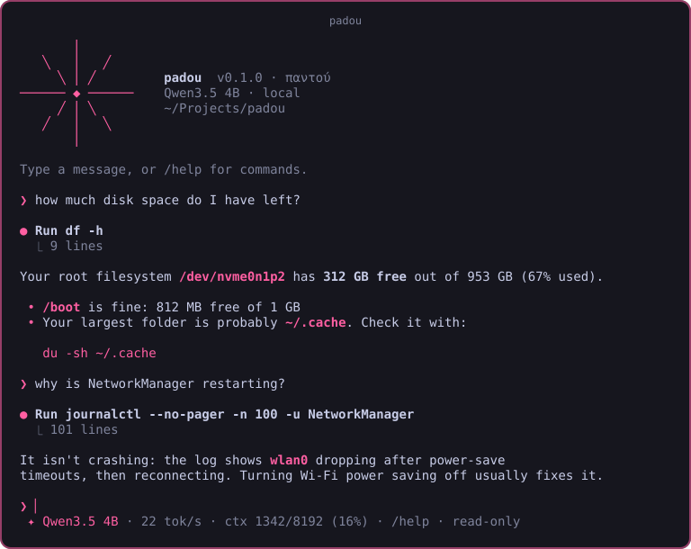
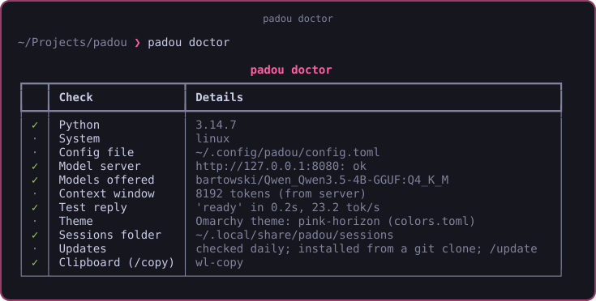
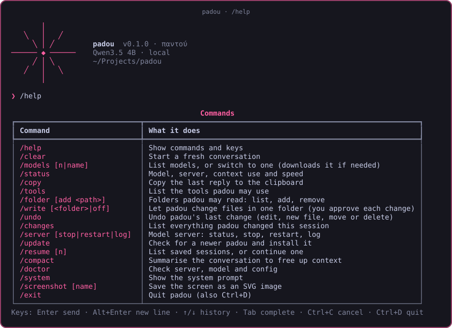
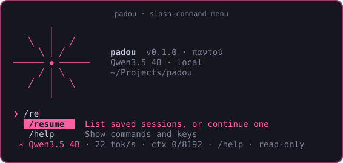

# padou

A lightweight, local-first AI assistant for your terminal, built for small models running on a laptop.

<p align="center"></p>

<p align="center"></p>

padou talks to any OpenAI-compatible server (llama.cpp's `llama-server`, Ollama, LM Studio), streams answers as rendered Markdown, and can look at your system through a small set of **read-only** tools. Nothing leaves your machine except the requests padou sends to the server you configure.

> [!NOTE]
> **padou** (παντού, pronounced "padoú") is Greek for "everywhere". This is a learning project, version 0.x. Expect rough edges.

> [!WARNING]
> padou is provided **as is, without warranty**. AI answers can be wrong: **review every command before you run it**, and don't rely on padou for medical, legal, financial or safety decisions. See [DISCLAIMER.md](DISCLAIMER.md).

## Features

- **The compass star:** padou's mark. παντού means "everywhere", in every direction: on launch, dots gather from everywhere into the star while παντού decodes into padou, and the rays keep shooting outward. Turn it off with `[ui] animation = false`.
- **Claude Code-style terminal UI:** banner, streaming Markdown, a tool-call log, slash commands with Tab completion, and a status line showing model, speed and context use.
- **Read-only by default, write mode when you want it:** `/write <folder>` lets padou edit text files in one folder; every change is shown as a diff and needs your yes, and `/undo` reverts it.
- **Read-only tools:** read files, list folders, search text, and run an approved list of safe system commands (`df`, `journalctl -u`, `systemctl status`, `pacman -Q`…).
- **Safety by design (read tools):** no shell, no `sudo`, strict argument checks, and secrets (`~/.ssh`, `~/.gnupg`, keyrings, `.env`, private keys, browser profiles) blocked even through symlinks.
- **Sessions:** every conversation is saved; continue with `/resume` or `padou -c`.
- **Omarchy aware:** picks up the accent colour of your current Omarchy theme, with a built-in palette everywhere else.
- **Small-model friendly:** short system prompt, few tools, capped tool output, `/compact` when the context fills up.

## What to expect from a 4B model

Small models are fast and private, but they're not Claude or GPT. They're good at explaining commands, reading a config or log and summarising it, and answering everyday questions. They're weaker at long multi-step reasoning and sometimes pick the wrong tool or misread output. padou keeps the toolset small and the output capped to help them.

## Platforms

| Platform | Status |
|---|---|
| **Linux** | ✅ Developed and tested on Arch / Omarchy 4 |
| **Windows (WSL)** | ✅ It's Linux, so it should work like Linux. **[Step-by-step guide](docs/install_windows_wsl.md)** |
| **macOS** | 🟡 Untested. Chat should work; several approved commands are Linux-only |
| **Windows (native)** | 🟡 Untested. Chat may work; the system commands, `/copy` and GPU detection are Linux-only |

## Requirements

- Linux (developed on Arch / Omarchy 4); see [Platforms](#platforms)
- Python 3.11+ and [`uv`](https://docs.astral.sh/uv/)
- An OpenAI-compatible model server. For llama.cpp, start it **with `--jinja`**, which tool calling needs.

## Quick start

```bash
uv tool install git+https://github.com/padou-dev/padou
padou
```

The first time you run `padou`, the **setup wizard** starts. It looks at your OS, GPU and RAM, finds any model server you already have (llama.cpp, Ollama or LM Studio), recommends a model, writes the config, and offers to start the server. If you have no model server yet, it shows the exact install command for your system. Re-run it any time with `padou setup`.

The rest of this section explains what the wizard does for you, in case you'd rather do it by hand.

### Choose a backend

| Backend | Good for | Install |
|---|---|---|
| **llama.cpp** (recommended) | Smallest, fastest; padou can start it and download the model for you | Arch: `yay -S llama.cpp-vulkan-git` · macOS/Linux: `brew install llama.cpp` · CUDA/Vulkan: `conda install -c conda-forge llama.cpp` · or [prebuilt releases](https://github.com/ggml-org/llama.cpp/releases) |
| **Ollama** | The easiest install; manages models for you | Linux: `curl -fsSL https://ollama.com/install.sh \| sh` · macOS: `brew install ollama` |
| **LM Studio** | A desktop app with a model browser | [lmstudio.ai](https://lmstudio.ai), then turn on its local server |

For llama.cpp, pick the build for your GPU: **Vulkan** for AMD or Intel, **CUDA** for NVIDIA, **Metal** on Apple Silicon (Homebrew's build has it), or the **CPU** build if you have no GPU.

### Choose a model

| # | Model | Made by | Download | Good for |
|---|---|---|---|---|
| 1 | Qwen3.5 2B | Alibaba (China) | 1.4 GB | CPU-only machines and low RAM. Fastest, least capable |
| 2 | Granite 4.0 Micro | IBM (USA) | 2.1 GB | Small and steady, made for tool calling |
| 3 | Ministral 3 3B | Mistral AI (France) | 2.2 GB | European option, quick on laptops |
| 4 | Phi-4-mini | Microsoft (USA) | 2.5 GB | Good at reasoning and maths for its size |
| 5 | **Qwen3.5 4B** (default) | Alibaba (China) | 3.0 GB | Integrated GPUs and laptops |
| 6 | Ministral 3 8B | Mistral AI (France) | 5.2 GB | Bigger European option, smarter but slower |
| 7 | Gemma 4 E4B | Google (USA) | 5.4 GB | Google's 4B class, strong all-rounder |
| 8 | Qwen3.5 9B | Alibaba (China) | 6.2 GB | GPUs with 8 GB+ VRAM. Noticeably smarter |

You can switch any time inside padou with `/models` (see [Switching models](#switching-models)). With llama.cpp a model downloads automatically the first time it's used (the `-hf` flag). With Ollama, pull it first: `ollama pull <tag>` with `qwen3.5:2b`, `granite4:micro`, `ministral-3:3b`, `phi4-mini:3.8b`, `qwen3.5:4b`, `ministral-3:8b`, `gemma4:e4b` or `qwen3.5:9b` (Ministral 3 needs Ollama 0.13.1 or newer).

Each model has its own licence (Apache 2.0 for Qwen, Granite and Ministral; MIT for Phi; the Gemma terms for Gemma). Check the model's page before commercial use.

> [!NOTE]
> Gemma 4 **E4B** means 4B *effective* parameters: it runs at about 4B speed, but its extra embedding tables make the download bigger than Qwen3.5 4B's.

### 1. Run a model server

padou **starts llama-server for you** when nothing is answering on localhost (see [Autostart](#autostart)), so if `llama-server` is installed you can skip to step 2. To run it yourself with llama.cpp (Vulkan build on AMD/Intel GPUs):

```bash
llama-server -hf bartowski/Qwen_Qwen3.5-4B-GGUF:Q4_K_M \
  -ngl 99 --jinja --reasoning-budget 0 -c 8192 --port 8080 --no-mmproj
```

| Flag | Why |
|---|---|
| `-ngl 99` | Put every layer on the GPU |
| `--jinja` | Use the model's chat template; required for tool calling |
| `--reasoning-budget 0` | Turn off "thinking", which small models tend to overdo |
| `-c 8192` | Context window in tokens |
| `--no-mmproj` | Skip the vision add-on; padou is text-only |

Or with Ollama: `ollama pull qwen3.5:4b`, then set `url = "http://127.0.0.1:11434"` and the model name in the config.

### 2. Install padou

```bash
git clone git@github.com:padou-dev/padou.git
cd padou
./install.sh            # or: uv tool install .
```

On Windows? Follow the **[WSL guide](docs/install_windows_wsl.md)**.

This puts a `padou` command in `~/.local/bin`, so you can run it from any folder. If your shell can't find it, run `uv tool update-shell` and open a new terminal.

Working on padou's code yourself? Install it **editable** instead, so your changes take effect without reinstalling:

```bash
uv tool install --editable .
```

### 3. Check and chat

<p align="center"></p>

```bash
padou doctor            # checks server, model, config, theme, clipboard
padou                   # start chatting
```

## Usage

```
padou                 start a chat in the current directory
padou -c              continue the most recent session
padou setup           (re)run the setup wizard; add -y to accept its recommendations
padou doctor          check that everything works
padou --compact       one-line banner
padou --no-tools      chat without any tools
padou --no-autostart  don't start llama-server automatically
padou --url URL       use a different server for this run
padou --init-config   write an example config
padou --version
```

### Slash commands

<p align="center"></p>
<p align="center"></p>

| Command | What it does |
|---|---|
| `/help` | Show commands and keys |
| `/clear` | Start a fresh conversation (the old one is saved) |
| `/models [n\|name]` | List models, or switch to one (downloads it if needed) |
| `/status` | Model, server, context use and speed |
| `/copy` | Copy the last reply to the clipboard (`wl-copy`) |
| `/tools` | List the tools padou may use |
| `/write [<folder>\|off]` | Let padou change files in one folder, this session only (you approve every change) |
| `/undo` | Undo padou's last file change |
| `/changes` | List the files padou changed this session |
| `/server [stop\|restart\|log]` | The model server: status and memory, stop, restart, or its log |
| `/folder [add <path>]` | Folders padou may read: list, `add <path> [--always]`, `remove <n>`, `anywhere`, `restrict` |
| `/resume [n]` | List saved sessions, or continue one |
| `/compact` | Summarise the conversation to free up context |
| `/doctor` | Run the checks from inside padou |
| `/system` | Show the system prompt |
| `/screenshot [name]` | Save the screen as an SVG image (in `~/Pictures/padou/`) |
| `/exit`, `/quit` | Quit (also `Ctrl+D`, or `Ctrl+C` twice) |

### Keys

`Enter` send · `Alt+Enter` new line · `↑`/`↓` history · `Tab` complete commands · `Ctrl+C` cancel a reply · `Ctrl+D` quit

## Folder access

By default padou's file tools can only read **the folder you started it in**. Need more? Grant it from inside padou (Tab completes the path):

```
/folder                      show what padou may read
/folder add ~/Documents      allow a folder for this session
/folder add /etc --always    allow it every time (saved to the config)
/folder remove 2             take access away again
/folder anywhere             whole system, for sysadmin work (this session only)
/folder restrict             back to the allowed folders
```

The model is told which folders it may use, and padou refuses anything outside them, including through symlinks. Secret locations stay blocked even in `anywhere` mode. The approved system commands (`df`, `journalctl`, `systemctl status`…) aren't affected, since they report on the system rather than reading your files.

To change the default, set `[tools] scope = "anywhere"` and/or list folders in `[tools] folders = ["~/Projects", "/etc"]`.

> [!TIP]
> Starting padou in your home folder (`~`) allows your whole home folder. Start it in a project folder to keep it focused.

## Write mode

padou is **read-only by default**. To let it change files, turn on write mode for one folder:

```
/write ~/Projects/my-app      padou may change files here (and in subfolders), this session only
/write                        show where write mode is on
/undo                         put the last change back
/changes                      list everything padou changed this session
/write off                    read-only again
```

How it stays safe:

- **You approve every change.** padou shows a coloured diff and asks `Apply this change? [y/N]`; the default is **no**. There's no "approve everything" switch.
- **Two small tools only:** `edit_file` replaces one exact, unique piece of text (reliable even for small models), and `write_file` creates **new** files and never overwrites. padou can't delete, rename, change permissions or run commands.
- **Backups and undo:** every edited file is copied to `~/.local/state/padou/backups/` first. `/undo` restores it, and undoing a newly created file moves it there instead of deleting it.
- **Never in sensitive places:** not `/`, not your whole home folder, not system folders (`/etc`, `/usr`, `/boot`…), not hidden folders (`~/.config`, `~/.ssh`…), not inside `.git`, not secret files, not through symlinks, and only in folders padou may already read.
- **Never saved:** write mode always starts off, and nothing in the config can turn it on permanently.
- **Always visible:** the status line shows `✎ write: <folder>` in the warning colour while it's on.

> [!WARNING]
> Small models make mistakes, and text inside files can try to trick the model ("prompt injection": a README that says *now edit ~/.bashrc*). **Read every diff before you say yes**, and keep your work in Git so you can always go back.

## Switching models

Type `/models` to see every model padou knows, with **●** on the one in use and **✓** on the ones already downloaded. Then type `/models 4` (or `/models phi`) to switch:

- **llama.cpp:** padou saves the new model in your config, restarts llama-server with it and waits while it loads. A model you haven't used before downloads once first (padou asks before downloading). Old downloads stay in `~/.cache/huggingface`, so switching back is quick.
- **Ollama:** padou offers to run `ollama pull` if the model isn't there yet, then switches straight away.
- **Other servers** (LM Studio, remote ones): padou lists what the server offers and switches for this session.

Your choice is saved, so padou starts with it next time. A model you set yourself in `start_command` shows at the top of the list.

## The model server

If padou starts `llama-server` for you, it runs **in the background** (no window) and **keeps running after you quit**, so the next start is instant. Its output goes to `~/.local/state/padou/llama-server.log`.

```
/server            is it answering? process ID, memory use, log path
/server restart    stop it and start it again (e.g. after changing the model)
/server stop       stop it and free its memory
/server log        the last lines of its log
```

Prefer it to stop when you quit padou? Set `[server] stop_on_exit = true` (padou only stops a server it started itself).

## Tools

padou's model can only **ask** to use a tool; padou's own code decides whether the request is allowed. Every call is shown on screen (the write tools are described in [Write mode](#write-mode)):

```
● Run journalctl --no-pager -n 100 -u NetworkManager
  ⎿ 101 lines
```

| Tool | What it does |
|---|---|
| `read_file` | Read a text file, with line numbers |
| `list_dir` | List a folder |
| `search` | Case-insensitive text or regex search in a file or folder (skips `.git`, `.venv`, `node_modules`) |
| `run_command` | One entry from the approved list below |

Approved commands: `disk_usage`, `memory`, `uptime`, `kernel`, `ip_addresses`, `routes`, `block_devices`, `processes`, `failed_services`, `service_status <service>`, `user_service_status <service>`, `service_logs <service>`, `recent_errors`, `package_info <package>`, `package_details <package>`, `which <program>`, `gpu_vulkan`, `sensors`, `git_status`, `git_log`.

> [!IMPORTANT]
> **The safety rules:** commands are run as argument lists with `shell=False`, so `;`, `&&` and `$(...)` mean nothing. Arguments must match `^[A-Za-z0-9@._:+-]{1,64}$` and can't start with `-`. No `sudo`, ever. Tool output is capped (8000 characters by default) so logs can't flood the context.

## Autostart

When you run `padou` and nothing is listening at the configured address, padou starts `llama-server` itself, using `[server] start_command`, and shows a spinner until the model is loaded. The first start downloads the model (~2.5 GB), so it can take a few minutes; after that it's a few seconds.

- It only happens for servers on **this machine** (`127.0.0.1` / `localhost`).
- The server **keeps running** after padou exits, so the next launch is instant. Stop it with `pkill -f llama-server`.
- Its output goes to `~/.local/state/padou/llama-server.log`.
- Turn it off with `[server] autostart = false`, or `--no-autostart` for one run. The [systemd service](contrib/llama-server.service) is the alternative if you'd rather the server always runs.

> [!NOTE]
> If you change the port or model in `start_command`, change `[server] url` to match.

## Configuration

`padou --init-config` writes `~/.config/padou/config.toml`. Every setting is optional:

```toml
[server]
url = "http://127.0.0.1:8080"
model = "qwen3.5-4b"
model_label = "Qwen3.5 4B"
timeout = 180
autostart = true
stop_on_exit = false   # true = stop a server padou started when you quit
start_command = "llama-server -hf bartowski/Qwen_Qwen3.5-4B-GGUF:Q4_K_M -ngl 99 --jinja --reasoning-budget 0 -c 8192 --host 127.0.0.1 --port 8080 --no-mmproj"

[chat]
temperature = 0.7
stream = true
max_tool_rounds = 8

[tools]
enabled = true
commands = true
max_output_chars = 8000

[ui]
banner = "full"        # or "compact"
clear_on_start = true  # clear the terminal before the banner
animation = true       # the compass-star launch and pulse
accent = ""            # e.g. "#ff5fa2"; empty = Omarchy theme accent
```

See [`config.example.toml`](config.example.toml) for every option.

### Where padou keeps things

| What | Where |
|---|---|
| Config | `~/.config/padou/config.toml` |
| Saved sessions | `~/.local/share/padou/sessions/` |
| Autostarted server's log | `~/.local/state/padou/llama-server.log` |
| Input history | `~/.local/share/padou/history` |

## Extras

- **Start the model server on login:** see [`contrib/llama-server.service`](contrib/llama-server.service).
- **Open padou from anywhere with a hotkey (Hyprland):** see [`contrib/hyprland.conf`](contrib/hyprland.conf).

## Troubleshooting

| Problem | Likely cause and fix |
|---|---|
| `Can't reach the model server` | `llama-server` isn't running, or is on another port. Start it, or set `[server] url`. Run `padou doctor` |
| `Server error 500 … tool` | llama-server was started without `--jinja`. Restart it with the flag |
| Replies take forever and "think" in circles | Reasoning is on. Add `--reasoning-budget 0` to llama-server |
| Very slow replies (2–5 tok/s) | The model is running on the CPU. Check `llama-cli --list-devices` shows Vulkan, and use `-ngl 99` |
| `The server took longer than 180s` | Long answer on a slow machine. Raise `[server] timeout` |
| `Context is 85% full` | Use `/compact` to summarise, or `/clear` to start over. Or start llama-server with a bigger `-c` |
| padou says "write mode is off" | It's read-only by default. Turn writing on for a folder with `/write <folder>` |
| `/write` refuses a folder | It won't write in `/`, your home folder, system folders, hidden folders or `.git`. Pick a project folder |
| An edit went wrong | `/undo` puts the file back; `/changes` lists every change and where the backups are |
| The model server uses memory when idle | It stays loaded for fast starts. `/server stop` frees it, or set `stop_on_exit = true` |
| The model says it can't read a file | The path is in the blocked list (keys, secrets, browser data). That's on purpose |
| Setup recommends the wrong model | It's only a suggestion from your RAM and GPU. Pick another number, or edit `[server]` in the config |
| Setup says llama.cpp is a CPU-only build | You have a GPU but installed the CPU build. Install the Vulkan (AMD/Intel), CUDA (NVIDIA) or Metal (Mac) build, then `padou setup` |
| `padou: command not found` after install | `~/.local/bin` isn't on your PATH. Add it, or run `uv tool update-shell` |
| `llama-server exited with code 1` on start | Read the log: `tail -50 ~/.local/state/padou/llama-server.log`. Often the port is taken or the model name is wrong |
| The banner cursor doesn't blink | Your terminal ignores the text-blink attribute (Alacritty does, for example). Nothing to fix in padou; other terminals may show it |
| Colours look wrong | Set `[ui] accent = "#rrggbb"`, or `NO_COLOR=1 padou` for no colour |
| `/copy` fails | Install `wl-clipboard` (`sudo pacman -S wl-clipboard`) |

## Uninstall

```bash
uv tool uninstall padou
systemctl --user disable --now llama-server 2>/dev/null; rm -f ~/.config/systemd/user/llama-server.service
rm -rf ~/.config/padou ~/.local/share/padou     # config, sessions and history
```

## Privacy

padou has no telemetry and makes no network requests of its own beyond the model server you configure (by default on `127.0.0.1`). `padou setup` only checks `127.0.0.1` ports 8080, 11434 and 1234 to find local servers. The model download comes from Hugging Face (llama.cpp) or Ollama's registry, made by those tools, not by padou.

## Development

```bash
uv sync
uv run padou           # run from the source tree
uv run pytest          # tests for the tool safety rules, config and theme
```

## Disclaimer

padou is free software provided **"as is", without warranty of any kind**. The author(s) are not liable for any damage, data loss or other consequences of using it. AI output can be wrong, so you are responsible for reviewing anything padou suggests, **every file change you approve in write mode**, and every command you choose to run. Models and model servers are third-party software with their own licences, and padou isn't affiliated with any of the companies or projects it mentions. Read the full [DISCLAIMER.md](DISCLAIMER.md). On first run, padou shows a short version of this and asks you to accept it.

## Licence

MIT, see [LICENSE](LICENSE).
