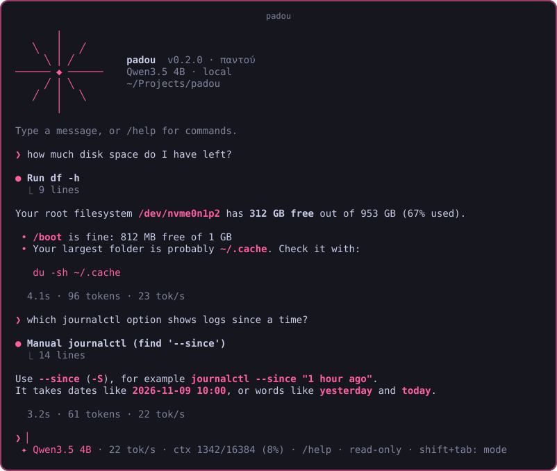
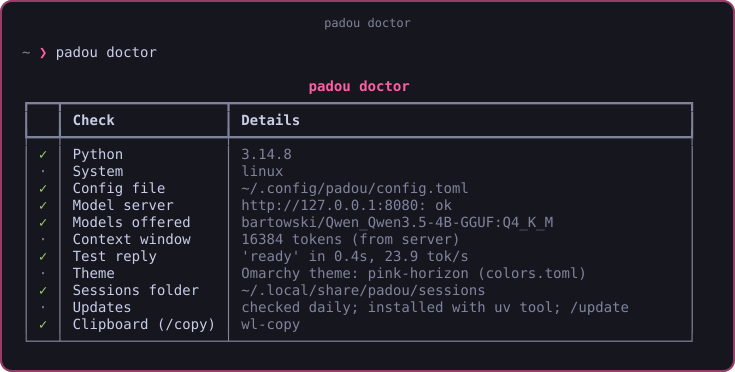
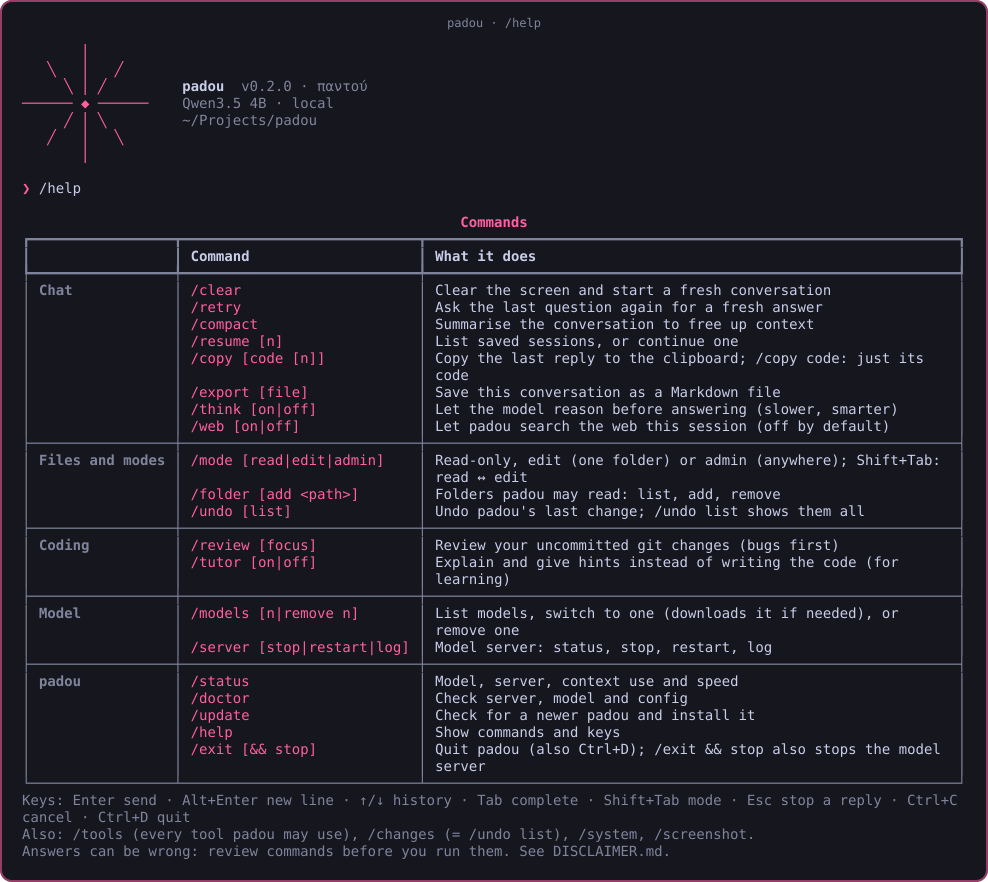
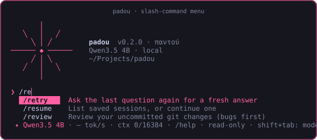
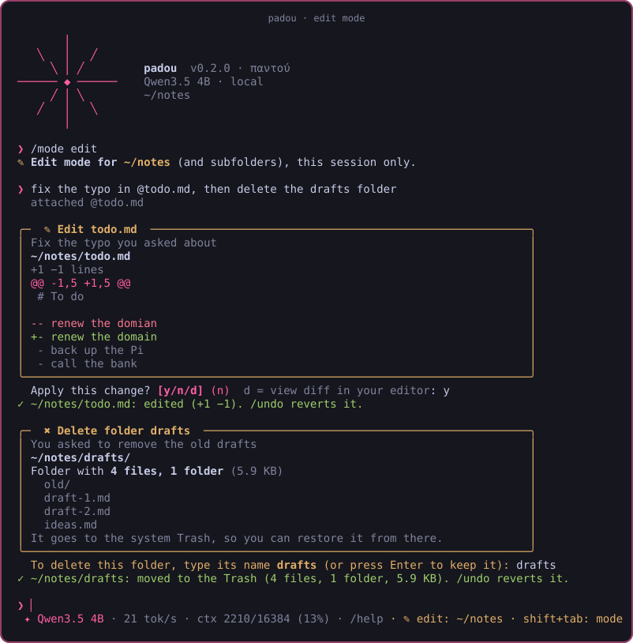

# padou

A lightweight, local-first AI assistant for your terminal, built for small models running on a laptop.

<p align="center"></p>

<p align="center"></p>

padou talks to any OpenAI-compatible server (llama.cpp's `llama-server`, Ollama, LM Studio), streams answers as rendered Markdown, and can look at your system through a small set of **read-only** tools, or, when you allow it, change files with your approval. Nothing leaves your machine except the requests padou sends to the server you configure.

> [!NOTE]
> **padou** (παντού, pronounced "padoú") is Greek for "everywhere". This is a learning project, version 0.x. Expect rough edges.

> [!WARNING]
> padou is provided **as is, without warranty**. AI answers can be wrong: **review every command before you run it**, and don't rely on padou for medical, legal, financial or safety decisions. See [DISCLAIMER.md](DISCLAIMER.md).

## Features

- **The compass star:** padou's mark. παντού means "everywhere", in every direction: on launch, dots gather from everywhere into the star while παντού decodes into padou, and the rays keep shooting outward. Turn it off with `[ui] animation = false`.
- **Claude Code-style terminal UI:** banner, streaming Markdown, a tool-call log, slash commands with Tab completion, and a status line showing model, speed and context use.
- **Linux, macOS and Windows:** one padou for all three, with the right commands, folders and Trash for each system.
- **Read-only by default, edit and admin modes when you want them:** `/mode edit` lets padou edit, create, move and delete (to the Trash) files in one folder, `/mode admin` anywhere, with system files through `sudo`. Every change is shown in a confirmation box and needs your yes, `/undo` reverts it, and an audit log records it.
- **Read-only tools:** read files, list folders, search text, and run an approved list of safe system commands for your OS (`df`, `systemctl status`, `ipconfig`, `sw_vers`…).
- **Safety by design:** no shell, no `sudo`, strict argument checks, and secrets (SSH and GPG keys, keychains and credential stores, `.env`, private keys, browser profiles) blocked even through symlinks.
- **Updates:** once a day padou checks quietly for a new version; `/update` installs it.
- **Sessions:** every conversation is saved; continue with `/resume` or `padou -c`.
- **Omarchy aware:** picks up the accent colour of your current Omarchy theme, with a built-in palette everywhere else.
- **Small-model friendly:** short system prompt, few tools, capped tool output, `/compact` when the context fills up.

## What to expect from a 4B model

Small models are fast and private, but they're not Claude or GPT. They're good at explaining commands, reading a config or log and summarising it, and answering everyday questions. They're weaker at long multi-step reasoning and sometimes pick the wrong tool or misread output. padou keeps the toolset small and the output capped to help them.

## Platforms

One padou runs everywhere: the same code, with the right commands, folders and Trash for each system.

| Platform | Status |
|---|---|
| **Linux** | ✅ Developed and used daily on Arch / Omarchy 4 |
| **Windows 10 / 11** | ✅ Native, in PowerShell or Windows Terminal. **[Install guide](docs/install_windows.md)** |
| **Windows (WSL)** | ✅ Works like Linux. **[WSL guide](docs/install_windows_wsl.md)** |
| **macOS** | ✅ Apple Silicon and Intel (Metal on Apple Silicon) |

Every push is tested automatically on Linux, macOS and Windows by GitHub Actions ([the tests](.github/workflows/tests.yml)). Day-to-day use is mostly on Linux, so if something feels off on your system, please open an issue.

## Requirements

- Linux, macOS or Windows; see [Platforms](#platforms)
- [`uv`](https://docs.astral.sh/uv/) (it installs Python 3.11+ for you if needed)
- An OpenAI-compatible model server. For llama.cpp, start it **with `--jinja`**, which tool calling needs.

## Quick start

```bash
uv tool install git+https://github.com/padou-dev/padou
padou
```

On Windows, in PowerShell: `irm https://raw.githubusercontent.com/padou-dev/padou/main/install.ps1 | iex` (it installs uv too if you want). See the [Windows guide](docs/install_windows.md).

The first time you run `padou`, the **setup wizard** starts. It looks at your OS, GPU and RAM, finds any model server you already have (llama.cpp, Ollama or LM Studio), recommends a model, writes the config, and offers to start the server. If you have no model server yet, it shows the exact install command for your system. Re-run it any time with `padou setup`.

The rest of this section explains what the wizard does for you, in case you'd rather do it by hand.

### Choose a backend

| Backend | Good for | Install |
|---|---|---|
| **llama.cpp** (recommended) | Smallest, fastest; padou can start it and download the model for you | Arch: `yay -S llama.cpp-vulkan-git` · macOS/Linux: `brew install llama.cpp` · Windows: `winget install llama.cpp` · CUDA/Vulkan: `conda install -c conda-forge llama.cpp` · or [prebuilt releases](https://github.com/ggml-org/llama.cpp/releases) |
| **Ollama** | The easiest install; manages models for you | Linux: `curl -fsSL https://ollama.com/install.sh \| sh` · macOS: `brew install ollama` |
| **LM Studio** | A desktop app with a model browser | [lmstudio.ai](https://lmstudio.ai), then turn on its local server |

For llama.cpp, pick the build for your GPU: **Vulkan** for AMD or Intel, **CUDA** for NVIDIA, **Metal** on Apple Silicon (Homebrew's build has it), or the **CPU** build if you have no GPU.

### Choose a model

| # | Model | Made by | Download | Good for |
|---|---|---|---|---|
| 1 | Qwen3.5 2B | Alibaba (China) | 1.4 GB | CPU-only machines and low RAM. Fastest, least capable |
| 2 | Granite 4.0 Micro | IBM (USA) | 2.1 GB | Small and steady, made for tool calling |
| 3 | Ministral 3 3B | Mistral AI (France) | 2.2 GB | European option, quick on laptops |
| 4 | Phi-4-mini | Microsoft (USA) | 2.5 GB | Good at reasoning and maths for its size |
| 5 | **Qwen3.5 4B** (default) | Alibaba (China) | 3.0 GB | Integrated GPUs and laptops |
| 6 | Ministral 3 8B | Mistral AI (France) | 5.2 GB | Bigger European option, smarter but slower |
| 7 | Gemma 4 E4B | Google (USA) | 5.4 GB | Google's 4B class, strong all-rounder |
| 8 | Qwen3.5 9B | Alibaba (China) | 6.2 GB | GPUs with 8 GB+ VRAM. Noticeably smarter |

You can switch any time inside padou with `/models` (see [Switching models](#switching-models)). With llama.cpp a model downloads automatically the first time it's used (the `-hf` flag). With Ollama, pull it first: `ollama pull <tag>` with `qwen3.5:2b`, `granite4:micro`, `ministral-3:3b`, `phi4-mini:3.8b`, `qwen3.5:4b`, `ministral-3:8b`, `gemma4:e4b` or `qwen3.5:9b` (Ministral 3 needs Ollama 0.13.1 or newer).

Each model has its own licence (Apache 2.0 for Qwen, Granite and Ministral; MIT for Phi; the Gemma terms for Gemma). Check the model's page before commercial use.

> [!NOTE]
> Gemma 4 **E4B** means 4B *effective* parameters: it runs at about 4B speed, but its extra embedding tables make the download bigger than Qwen3.5 4B's.

### 1. Run a model server

padou **starts llama-server for you** when nothing is answering on localhost (see [Autostart](#autostart)), so if `llama-server` is installed you can skip to step 2. To run it yourself with llama.cpp (Vulkan build on AMD/Intel GPUs):

```bash
llama-server -hf bartowski/Qwen_Qwen3.5-4B-GGUF:Q4_K_M \
  -ngl 99 --jinja --reasoning-budget 0 -c 8192 --port 8080 --no-mmproj
```

| Flag | Why |
|---|---|
| `-ngl 99` | Put every layer on the GPU |
| `--jinja` | Use the model's chat template; required for tool calling |
| `--reasoning-budget 0` | Turn off "thinking", which small models tend to overdo. Remove it to switch thinking per question with `/think` (padou offers to do this for you) |
| `-c 8192` | Context window in tokens |
| `--no-mmproj` | Skip the vision add-on; padou is text-only |

Or with Ollama: `ollama pull qwen3.5:4b`, then set `url = "http://127.0.0.1:11434"` and the model name in the config.

### 2. Install padou

```bash
git clone git@github.com:padou-dev/padou.git
cd padou
./install.sh            # Linux and macOS (or: uv tool install .)
```

On Windows, run `.\install.ps1` in PowerShell instead (see the **[Windows guide](docs/install_windows.md)**), or use the **[WSL guide](docs/install_windows_wsl.md)**.

This puts a `padou` command in `~/.local/bin` (`%USERPROFILE%\.local\bin` on Windows), so you can run it from any folder. If your shell can't find it, run `uv tool update-shell` and open a new terminal.

If the folder is a git clone, the installer sets padou up **editable**: it runs straight from the clone, so a `git pull` (or `/update`) takes effect the next time you start padou. A downloaded copy (no `.git` folder) is installed as a fixed copy instead.

To switch an existing install to editable yourself, run this in the clone:

```bash
uv tool install --editable .
```

### 3. Check and chat

<p align="center"></p>

```bash
padou doctor            # checks server, model, config, theme, clipboard
padou                   # start chatting
```

## Usage

```
padou                 start a chat in the current directory
padou -c              continue the most recent session
padou setup           (re)run the setup wizard; add -y to accept its recommendations
padou doctor          check that everything works
padou --compact       one-line banner
padou --no-tools      chat without any tools
padou --no-autostart  don't start llama-server automatically
padou --url URL       use a different server for this run
padou --init-config   write an example config
padou --version
```

### Slash commands

<p align="center"></p>
<p align="center"></p>

| Command | What it does |
|---|---|
| `/help` | Show commands and keys |
| `/clear` | Clear the screen and start a fresh conversation (the old one is saved, see `/resume`) |
| `/models [n\|remove n]` | List models, switch to one (downloads it if needed), or remove a downloaded one |
| `/status` | Model, server, context use and speed |
| `/retry` | Ask the last question again for a fresh answer (small models vary; attached files are read again) |
| `/copy [code [n]]` | Copy the last reply to the clipboard; `/copy code` copies just its last code block (`/copy code 1` the first) |
| `/export [file]` | Save the conversation as Markdown (default `padou-chat-<date>.md` in the current folder; never overwrites) |
| `/mode [read\|edit\|admin]` | Read-only, edit (one folder) or admin (anywhere, system files through sudo); `Shift+Tab` switches read ↔ edit |
| `/undo [list]` | Undo padou's last change (edits, new files, moves and deletions); `/undo list` shows every change this session |
| `/server [stop\|restart\|log]` | The model server: status and memory, stop, restart, or its log |
| `/update` | Check for a newer padou and install it |
| `/folder [add <path>]` | Folders padou may read: list, `add <path> [--always]`, `remove <n>`, `anywhere`, `restrict` |
| `/resume [n]` | List saved sessions, or continue one |
| `/compact` | Summarise the conversation to free up context |
| `/think [on\|off]` | Let the model reason before answering: smarter on hard questions, much slower (this session) |
| `/web [on\|off]` | Let padou search the web, this session only (off by default; see [Web search](#web-search)) |
| `/review [focus]` | Review your uncommitted git changes, bugs first (see [Coding](#coding)) |
| `/tutor [on\|off]` | Tutor mode: padou explains and gives hints instead of writing the code for you |
| `/doctor` | Run the checks from inside padou |
| `/exit`, `/quit` | Quit (also `Ctrl+D`, or `Ctrl+C` twice). `/exit && stop` also stops the model server |

`/help` shows these in groups. A few more work when typed, but stay out of the way: `/tools` (every tool padou may use), `/changes` (same as `/undo list`), `/system` (the system prompt) and `/screenshot [name]` (save the screen as an SVG in `~/Pictures/padou/`).

### Keys

`Enter` send (or, while suggestions show, take the suggestion) · `Alt+Enter` new line · `↑`/`↓` history · `Tab` complete commands · `Esc` stop a reply (keeps what's written) · `Ctrl+C` cancel a reply · `Ctrl+D` quit

While padou works you see what it's doing (`working…`, `thinking…`, `choosing a tool…`) and for how long; as the reply streams, its length and speed.

## Folder access

By default padou's file tools can only read **the folder you started it in**. Need more? Grant it from inside padou (Tab completes the path):

```
/folder                      show what padou may read
/folder add ~/Documents      allow a folder for this session
/folder add /etc --always    allow it every time (saved to the config)
/folder remove 2             take access away again
/folder anywhere             whole system, for sysadmin work (this session only)
/folder restrict             back to the allowed folders
```

The model is told which folders it may use, and padou refuses anything outside them, including through symlinks. Secret locations stay blocked even in `anywhere` mode. The approved system commands (`df`, `systemctl status`, `ipconfig`…) aren't affected, since they report on the system rather than reading your files.

To change the default, set `[tools] scope = "anywhere"` and/or list folders in `[tools] folders = ["~/Projects", "/etc"]`.

> [!TIP]
> Starting padou in your home folder (`~`) allows your whole home folder. Start it in a project folder to keep it focused.

## Modes: read-only, edit and admin

padou is **read-only by default**. Two modes let it change files, each only for this session:

```
/mode                         show the modes and which one is on
/mode edit                    padou may change files in the folder you started in (and its subfolders)
/mode edit ~/Projects/my-app  ...or in another folder (run it again to add more)
/mode admin                   padou may change files anywhere, system files through sudo
/mode read                    read-only again
Shift+Tab                     switch between read-only and edit (never admin)
/undo                         put the last change back (run it again for the one before)
/changes                      list everything padou changed this session
```

<p align="center"></p>

The status line at the bottom always shows the mode: `read-only`, `✎ edit: <folder>` or `✎ admin: anywhere`. Shift+Tab changes it quietly, right there.

What padou can do in edit and admin mode, each one only after you approve it:

| Tool | What it does |
|---|---|
| `edit_file` | Replace one exact, unique piece of text (reliable even for small models) |
| `rewrite_file` | Replace a whole file; you see the full diff |
| `write_file` | Create a **new** file (never overwrites), plus any missing folders, which are listed |
| `move_path` | Move or rename a file or folder; never overwrites |
| `delete_path` | Move a file or folder to the system **Trash** (Recycle Bin on Windows) |

How it stays safe, in both modes:

- **You approve every change in a confirmation box.** It shows exactly what will happen: a coloured diff, where something moves, or what's inside a folder about to be deleted. The answer defaults to **no**. There's no "approve everything" switch.
- **Deleting a folder means typing its name**, not just `y` (in admin mode, files too). The box shows how many files are inside, their size, and warnings (a `.git` repository, files that look like secrets).
- **Nothing is destroyed:** deleted things go to the system Trash, where you can restore them. padou also keeps its own copy of anything up to 20 MB, so `/undo` can bring it straight back.
- **Backups and undo:** edited files are copied to padou's backup folder first. `/undo` restores them, moves things back, and moves a newly created file aside rather than deleting it.
- **An audit log:** every change (and every undo) is written to `changes.log` in padou's state folder, with the time, the mode and whether sudo was used.
- **Never secrets, never `.git`, never through symlinks**, in any mode.
- **Never saved:** padou always starts read-only, and nothing in the config can change that. The model can't switch modes either: only you can, by typing.

### Edit mode

For working in a project. padou may change files in the edit folders only, and never in a drive root, your whole home folder, system folders (`/etc`, `/usr`, `C:\Windows`, `C:\Program Files`, `/System`…) or hidden and settings folders (`~/.config`, `AppData`, `~/Library`). An edit folder itself can't be deleted or moved. If you start padou in your home folder, pick a project: `/mode edit ~/Projects/my-app`.

### Admin mode

For changes anywhere, including your home folder, `~/.config` and system files like `/etc/hosts`. The first time, padou explains what it allows and asks you to confirm; after that, `/mode admin` just switches.

- **System files go through `sudo`.** When a change needs administrator rights, the box says so (and its title shows `· sudo`). After you approve it, `sudo` itself asks for your password: you type it into sudo, padou never sees it. sudo then remembers it for a few minutes, as usual.
- **System files can't go to the Trash**, so padou keeps a copy before deleting (and refuses if that copy would be over 20 MB). `/undo` puts them back, through sudo again. These copies belong to root, in padou's backup folder.
- **Still never:** secret locations, a drive root, your home folder or a main system folder as a whole (`/etc` itself can't be deleted), and the parts that keep the system running: `/proc`, `/sys`, `/dev`, `/run`, `/boot`, `/efi` (`/System` on macOS, `C:\Windows`).
- **Windows:** padou can't ask for administrator rights itself yet. For protected locations, start padou in a terminal opened with *Run as administrator*.

> [!WARNING]
> Small models make mistakes, and text inside files can try to trick the model ("prompt injection": a README that says *now delete the src folder*). **Read every box before you say yes**, especially in admin mode, and keep your work in Git so you can always go back.

## Switching models

Type `/models` to see every model padou knows, with **●** on the one in use and **✓** on the ones already downloaded. Then type `/models 4` (or `/models phi`) to switch:

- **llama.cpp:** padou saves the new model in your config, restarts llama-server with it and waits while it loads. A model you haven't used before downloads once first (padou asks before downloading). Old downloads stay in llama.cpp's cache, so switching back is quick (`/models remove` frees the space).
- **Ollama:** padou offers to run `ollama pull` if the model isn't there yet, then switches straight away.
- **Other servers** (LM Studio, remote ones): padou lists what the server offers and switches for this session.

Your choice is saved, so padou starts with it next time. A model you set yourself in `start_command` shows at the top of the list.

### Removing a model

Models are big (1.4 to 6.2 GB), so remove the ones you no longer use:

```
/models remove 4
```

padou shows the model's files and size and asks first (the default is no). Then:

- **llama.cpp:** the files go to the **Trash** (the **Recycle Bin** on Windows), so you can still restore them. The disk space is freed once you empty the Trash.
- **Ollama:** Ollama deletes the model for good (it has no Trash).

You can't remove the model you're using: switch to another one first. A removed model downloads again if you pick it later.

## The model server

If padou starts `llama-server` for you, it runs **in the background** (no window) and **keeps running after you quit**, so the next start is instant. Its output goes to `llama-server.log` in padou's state folder (see [Where padou keeps things](#where-padou-keeps-things)).

```
/server            is it answering? process ID, memory use, log path
/server restart    stop it and start it again (e.g. after changing the model)
/server stop       stop it and free its memory
/server log        the last lines of its log
```

Prefer it to stop when you quit padou? Set `[server] stop_on_exit = true` (padou only stops a server it started itself).

## Updates

Once a day, in the background, padou asks GitHub whether a newer version has been released. It never slows the start, and it sends nothing about you or your conversations: it's one request for the latest release. If there's a new one you'll see:

```
✓ padou 0.3.0 is available (you have 0.2.0). Type /update to get it.
```

and `⬆ 0.3.0 available: /update` in the status line. `/update` shows what's new, asks, and installs it the way you installed padou:

- **From a git clone** (`uv tool install --editable .`): `git pull`, plus a reinstall if the dependencies changed. It refuses if you have uncommitted changes.
- **With `uv tool install git+https://...`**: the same install, pinned to the new version.
- **On Windows**, a running program can't replace itself, so the install finishes in a new window right after you quit padou.

Turn the daily check off with `[updates] check = false` (or `PADOU_NO_UPDATE_CHECK=1`). `/update` still works whenever you type it.

## Tools

padou's model can only **ask** to use a tool; padou's own code decides whether the request is allowed. Every call is shown on screen (the tools that change files are described in [Modes](#modes-read-only-edit-and-admin)):

```
● Run journalctl --no-pager -n 100 -u NetworkManager
  ⎿ 101 lines
```

| Tool | What it does |
|---|---|
| `read_file` | Read a text file, with line numbers |
| `list_dir` | List a folder |
| `search` | Case-insensitive text or regex search in a file or folder (skips `.git`, `.venv`, `node_modules`) |
| `man_page` | Read a program's manual installed on your computer (`man`; `Get-Help` on Windows), or just the parts about one option, so answers about options come from the real documentation |
| `run_command` | One entry from the approved list below |

Approved commands, per system (type `/tools` to see yours):

| System | Commands |
|---|---|
| **Linux** | `disk_usage`, `memory`, `uptime`, `kernel`, `ip_addresses`, `routes`, `listening_ports`, `block_devices`, `processes`, `failed_services`, `service_status <service>`, `user_service_status <service>`, `service_logs <service>`, `recent_errors`, `package_info <package>` and `package_details <package>` (pacman, dpkg or rpm, whichever you have), `which <program>`, `gpu_vulkan`, `sensors` |
| **macOS** | `disk_usage`, `memory`, `uptime`, `os_version`, `kernel`, `hardware`, `gpu`, `battery`, `ip_addresses`, `routes`, `listening_ports`, `block_devices`, `processes`, `services`, `recent_errors`, `package_info <package>` (Homebrew), `which <program>` |
| **Windows** | `disk_usage`, `memory`, `uptime`, `os_version`, `hardware`, `ip_addresses`, `routes`, `listening_ports`, `processes`, `stopped_services`, `service_status <service>`, `recent_errors`, `package_info <package>` (winget), `which <program>` |
| **All** | `git_status`, `git_log`, `git_diff`, `git_diff_staged` |

On Windows a few of these are short, fixed PowerShell one-liners written into padou; the model can never add to them.

> [!IMPORTANT]
> **The safety rules:** commands are run as argument lists with `shell=False`, so `;`, `&&` and `$(...)` mean nothing. Arguments must match `^[A-Za-z0-9@._:+-]{1,64}$` and can't start with `-`. No `sudo` in these tools. Tool output is capped (8000 characters by default) so logs can't flood the context: long output keeps its start and its end (where results and errors usually are) with a note about what was skipped.

### When things go wrong

Small models sometimes fumble a tool call. padou helps them recover instead of failing: a broken call gets an error with an example of a correct one; a call written as text (`<tool_call>…</tool_call>`) is run as a real call; and the same failing call is stopped after two tries, so the model explains the problem instead of looping. When the conversation fills about 80% of the model's memory, padou summarises the older part by itself and keeps your last exchange word for word (`auto_compact` under `[chat]`).

## Web search

padou is offline by default. `/web on` lets it search the web for the rest of the session, and the status line shows `web` while it's on. `/web off` switches it off again.

- **What leaves your computer:** only the search words, sent to the search provider, and requests for the pages padou reads, sent straight to those sites. Never your files or the conversation.
- **When it's used:** for anything that may have changed since the model was trained: new versions, releases, defaults, news. For questions about your own computer, padou uses its local tools first.
- **What you see:** every search and page shows up like any other tool call (`● Web search 'ubuntu 26.04 default terminal'`).
- **Never the local network:** padou won't read pages on your computer or your home network (`localhost`, `192.168.x.x`, `*.local`).

Providers, under `[web]` in the config:

| `provider` | Needs | Notes |
|---|---|---|
| `duckduckgo` (default) | nothing | Reads DuckDuckGo's plain results page. It isn't an official API, so it can be blocked for a while or break when DuckDuckGo changes its page; padou then says so |
| `searxng` | `url` of your own [SearXNG](https://docs.searxng.org/) | Private and reliable, for example on a home server. Switch on its JSON output (`search: formats: [html, json]` in `settings.yml`) |
| `brave` | `api_key` for the [Brave Search API](https://brave.com/search/api/) | Reliable; a small free monthly credit, then paid |

To start every session with web search on, set `enabled = true` under `[web]`.

## Coding

Start padou inside a project (a folder with `pyproject.toml`, `package.json`, `Cargo.toml`, `go.mod`, a `Makefile` or `.git`) and it switches to coding mode by itself. Under the banner it says what it found, for example `Coding project: Python · lantern · git · can run its test, lint`.

- **`@path` attaches a file** to your message: `why does @src/app.py crash on empty input?` (`Tab` completes the path). padou reads it straight away, so the model doesn't have to ask.
- **Tests, linters and builds:** padou finds the project's own commands (`uv run pytest`, `npm run test`, `cargo test`, `go vet ./...`, `make lint`…) and, in edit or admin mode, the model can ask to run one after a change. You approve each run, or answer `a` to allow that command for the rest of the session. padou never invents a command: only the ones it found, and only if the program is installed.
- **`/review`** asks the model to look at your uncommitted changes (`git diff`) and list problems, most important first, without changing anything. `/review error handling` focuses it.
- **See a change in your editor:** if VS Code, Code OSS or VSCodium is installed, the confirmation box for an edit offers `d`, which opens the change side by side in the editor. Then answer `y` or `n` as usual.
- **`/tutor on`** is for learning: padou explains, gives hints and asks what you think the next step is, instead of writing the code. The status line shows `tutor`.

> [!TIP]
> **Autocomplete while you type in Code OSS:** padou is the chat and editing side. For grey-text suggestions as you type, install [llama.vscode](https://github.com/ggml-org/llama.vscode) from [Open VSX](https://open-vsx.org/extension/ggml-org/llama-vscode) (the store Code OSS uses). It's made by the llama.cpp team and runs a small autocomplete model next to padou's; its README suggests a 1.5B Qwen Coder model for machines with little memory. Run padou in Code OSS's terminal panel (`` Ctrl+` ``) to have both in one window.

A 4B model is good at explaining code and errors, small functions, scripts and regexes, and focused fixes in one file. It's weaker at big changes across many files: break those into steps. `padou bench` includes two coding questions, so you can compare models for this too.

## Testing a model: `padou bench`

```bash
padou bench
```

It asks the model 17 fixed questions in a practice folder with known files (a README, a config, notes, a log, some code), lets it use padou's read-only tools, and scores each answer: did it use the right tool, and is the answer right? It also includes a few traps, like a file that doesn't exist, which the model must admit rather than invent. Nothing on your computer is changed and nothing goes online. The score and times are saved under padou's state folder (`bench/`), so you can compare models (`/models`), settings and padou versions.

## Autostart

When you run `padou` and nothing is listening at the configured address, padou starts `llama-server` itself, using `[server] start_command`, and shows a spinner until the model is loaded. The first start downloads the model (about 3 GB for the default), so it can take a few minutes; after that it's a few seconds.

- It only happens for servers on **this machine** (`127.0.0.1` / `localhost`).
- The server **keeps running** after padou exits, so the next launch is instant. Stop it with `/server stop`.
- Its output goes to padou's state folder (see [Where padou keeps things](#where-padou-keeps-things)); `/server log` shows it.
- Turn it off with `[server] autostart = false`, or `--no-autostart` for one run. The [systemd service](contrib/llama-server.service) is the alternative if you'd rather the server always runs.

> [!NOTE]
> If you change the port or model in `start_command`, change `[server] url` to match.

## Configuration

`padou --init-config` writes the config file (where: see below; `padou doctor` shows it too). Every setting is optional:

```toml
[server]
url = "http://127.0.0.1:8080"
model = "qwen3.5-4b"
model_label = "Qwen3.5 4B"
timeout = 180
autostart = true
stop_on_exit = false   # true = stop a server padou started when you quit
start_command = "llama-server -hf bartowski/Qwen_Qwen3.5-4B-GGUF:Q4_K_M -ngl 99 --jinja --reasoning-budget 0 -c 8192 --host 127.0.0.1 --port 8080 --no-mmproj"

[chat]
temperature = 0.7
stream = true
max_tool_rounds = 8

[tools]
enabled = true
commands = true
max_output_chars = 8000

[ui]
banner = "full"        # or "compact"
clear_on_start = true  # clear the terminal before the banner
animation = true       # the compass-star launch and pulse
accent = ""            # e.g. "#ff5fa2"; empty = Omarchy theme accent

[updates]
check = true           # once a day, ask GitHub if a newer padou exists
```

See [`config.example.toml`](config.example.toml) for every option.

### Where padou keeps things

| What | Linux and macOS | Windows |
|---|---|---|
| Config | `~/.config/padou/config.toml` | `%APPDATA%\padou\config.toml` |
| Saved sessions | `~/.local/share/padou/sessions/` | `%LOCALAPPDATA%\padou\data\sessions\` |
| Input history | `~/.local/share/padou/history` | `%LOCALAPPDATA%\padou\data\history` |
| Server log, backups, update check | `~/.local/state/padou/` | `%LOCALAPPDATA%\padou\state\` |

## Extras

- **Start the model server on login:** see [`contrib/llama-server.service`](contrib/llama-server.service).
- **Open padou from anywhere with a hotkey (Hyprland):** see [`contrib/hyprland.conf`](contrib/hyprland.conf).

## Troubleshooting

| Problem | Likely cause and fix |
|---|---|
| `Can't reach the model server` | `llama-server` isn't running, or is on another port. Start it, or set `[server] url`. Run `padou doctor` |
| `Server error 500 … tool` | llama-server was started without `--jinja`. Restart it with the flag |
| Replies take forever and "think" in circles | Reasoning is on. `/think off`, or add `--reasoning-budget 0` to llama-server |
| Very slow replies (2–5 tok/s) | The model is running on the CPU. Check `llama-cli --list-devices` shows Vulkan, and use `-ngl 99` |
| `The server took longer than 180s` | Long answer on a slow machine. Raise `[server] timeout` |
| `Context is 85% full` | Use `/compact` to summarise, or `/clear` to start over. Or start llama-server with a bigger `-c` |
| padou says it's "read-only right now" | That's the default. Allow changes with `/mode edit` (a folder) or `/mode admin` (anywhere) |
| `/mode edit` refuses a folder | Edit mode won't work in `/`, your home folder, system folders, hidden folders or `.git`. Pick a project folder, or use `/mode admin` |
| sudo says "a terminal is required" | Run padou in a normal terminal window (not through a pipe or a script), so sudo can ask for your password |
| An edit went wrong | `/undo` puts the file back; `/changes` lists every change and where the backups are |
| The model server uses memory when idle | It stays loaded for fast starts. `/server stop` frees it, or set `stop_on_exit = true` |
| The model says it can't read a file | The path is in the blocked list (keys, secrets, browser data). That's on purpose |
| Setup recommends the wrong model | It's only a suggestion from your RAM and GPU. Pick another number, or edit `[server]` in the config |
| Setup says llama.cpp is a CPU-only build | You have a GPU but installed the CPU build. Install the Vulkan (AMD/Intel), CUDA (NVIDIA) or Metal (Mac) build, then `padou setup` |
| `padou: command not found` after install | uv's tool folder isn't on your PATH. Run `uv tool update-shell` and open a new terminal |
| `the server exited with code 1` on start | Read the log with `/server log`. Often the port is taken or the model name is wrong |
| A delete says the Trash can't take it | Some drives (network shares, some USB sticks) have no Trash. padou then refuses and deletes nothing |
| `/undo` says to restore from the Trash | The deleted item was over 20 MB, so padou didn't keep its own copy. Restore it from the Trash / Recycle Bin |
| `/update` says GitHub can't be reached | You're offline, or no release has been published yet. `/update` works fine again later |
| Windows: odd characters instead of the star or boxes | Use **Windows Terminal** (the default on Windows 11) rather than the old console window |
| Windows: `running scripts is disabled` | Run the installer with `powershell -ExecutionPolicy Bypass -File .\install.ps1` |
| The banner cursor doesn't blink | Your terminal ignores the text-blink attribute (Alacritty does, for example). Nothing to fix in padou; other terminals may show it |
| Colours look wrong | Set `[ui] accent = "#rrggbb"`, or `NO_COLOR=1 padou` for no colour |
| `/copy` fails | Linux: install `wl-clipboard` (Wayland) or `xclip` (X11). macOS and Windows have one built in |

## Uninstall

```bash
uv tool uninstall padou
systemctl --user disable --now llama-server 2>/dev/null; rm -f ~/.config/systemd/user/llama-server.service
rm -rf ~/.config/padou ~/.local/share/padou ~/.local/state/padou    # config, sessions, history, logs
```

On Windows, in PowerShell:

```powershell
uv tool uninstall padou
Remove-Item -Recurse "$env:APPDATA\padou", "$env:LOCALAPPDATA\padou"
```

## Privacy

padou has no telemetry. Its only network requests are to the model server you configure (by default on `127.0.0.1`) and, at most once a day, one request to GitHub's public API asking for the latest padou release (turn it off with `[updates] check = false`). Nothing about you or your conversations is sent. `padou setup` only checks `127.0.0.1` ports 8080, 11434 and 1234 to find local servers. The model download comes from Hugging Face (llama.cpp) or Ollama's registry, made by those tools, not by padou.

## Development

```bash
uv sync
uv run padou           # run from the source tree
uv run pytest          # tests for the safety rules, write mode, updates, config and theme
```

## Disclaimer

padou is free software provided **"as is", without warranty of any kind**. The author(s) are not liable for any damage, data loss or other consequences of using it. AI output can be wrong, so you are responsible for reviewing anything padou suggests, **every file change you approve in write mode**, and every command you choose to run. Models and model servers are third-party software with their own licences, and padou isn't affiliated with any of the companies or projects it mentions. Read the full [DISCLAIMER.md](DISCLAIMER.md). On first run, padou shows a short version of this and asks you to accept it.

## Licence

MIT, see [LICENSE](LICENSE).
